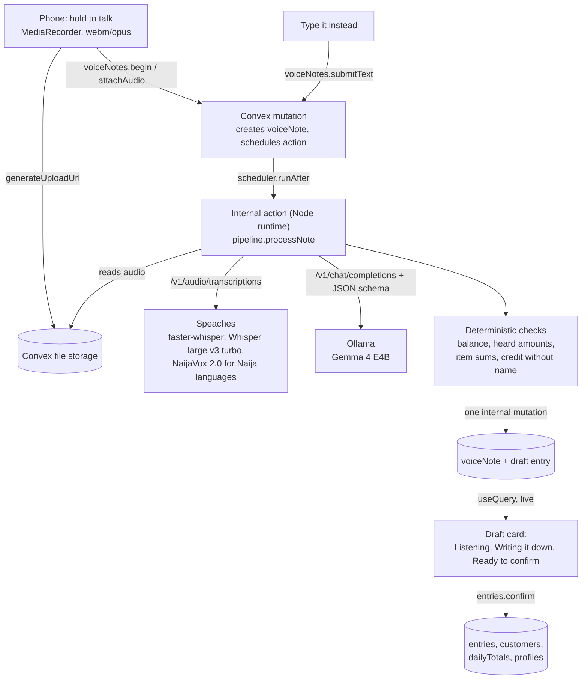

# SabiBook

Talk your sales. SabiBook writes them down and keeps track of who owes you.

A trader in Balogun market holds one big button and says:

> "I sold three bags of rice to Mama Ngozi for forty five thousand, she paid thirty five, she go balance me tomorrow."

A few seconds later a card appears. It reads Sale, Mama Ngozi, 3 bags of rice, ₦45,000 total, ₦35,000 paid, ₦10,000 still owed, note "will pay balance tomorrow". She taps Save. Mama Ngozi now shows up on the Debtors screen with ₦10,000 next to her name. When it's time to collect, SabiBook writes a polite reminder in English or Pidgin and opens WhatsApp with it.

Everything that touches her words runs on open weight models you can host yourself. Speech goes through Whisper and NaijaVox on a faster-whisper server. Gemma 4 turns the transcript into the ledger entry.

Built for the DEV Hacktoberfest Open Source AI Challenge, week 2 (Side Hustle).

## Who this is for, and who would pay

Small traders in Nigeria run on credit. A provision shop gives a regular customer two crates of eggs today and collects next week. A fabric seller lets a church member pay in three parts. The record of who owes what usually lives in an exercise book, a WhatsApp chat with yourself, or memory. That book is where money leaks. Entries get skipped on busy days, numbers get smudged, and nobody remembers whether Emeka paid the second half.

Typing is slow when you have customers in front of you, and most ledger apps assume you'll fill in a form. Talking takes about five seconds, and every trader already does it all day.

The people I think would pay:

- **Market traders and shop owners** with ten to a hundred credit customers. The app pays for itself the first time it recovers one forgotten debt. A small monthly subscription in naira, cheaper than a recharge card, is the obvious model.
- **Side hustlers.** The nurse who sells perfume to colleagues, the student reselling phone accessories, the woman baking for weekend orders. They need to know if the hustle makes money, and they won't open a spreadsheet.
- **Cooperatives and microfinance officers** who already ask members to keep records and would rather receive clean ones.

The hosted version is the business. The open source version means a cooperative or a tech hub in Kano can run the whole thing on its own server and pay nothing per request.

## What it does

- **Record by voice.** Hold the button and talk, or tap once to start and once to stop if holding is awkward. English is the main language, Pidgin is supported, and Yoruba, Hausa and Igbo are in beta.
- **Type it instead.** The same pipeline takes a typed sentence, minus the speech step.
- **Check before saving.** Every entry lands as a draft card first. You see the transcript, every field is editable, and anything the app is unsure about is highlighted in yellow with a short reason.
- **Ledger.** Entries grouped by day, plus a week view with daily sales and spending.
- **Debtors.** Everyone who owes you, their history, "Record payment" by voice or by tapping an amount, and "Send reminder", which drafts a short polite message and opens WhatsApp.
- **Receipts.** Any saved entry gets a public receipt page at `/r/<token>` that you can send on WhatsApp or print.
- **Installable.** It's a PWA built for cheap Android phones, with big touch targets, no heavy images and an offline page.
- **Try the demo.** A guest login with a sample book already filled in, so you can poke around without signing up.

## The part I care most about: it never invents money

A language model that guesses a number in a ledger is worse than no app at all. So the model's job is narrow. It reads the sentence and fills a JSON schema. Plain TypeScript does everything after that:

1. **Balance is arithmetic, not prediction.** `balance = total - paid`, computed in code.
2. **Every amount must be heard.** `convex/model/numbers.ts` pulls every number out of the transcript, whether spoken ("forty five thousand"), shortened ("45k", "two k") or written ("₦45,000"). If the model returns an amount that isn't one of those, or a product or sum of them, the field is flagged "I did not hear this".
3. **Dropped scales are allowed on purpose.** Traders say "forty five thousand, she paid thirty five" and mean 35,000. The check accepts a small number as thousands when a larger figure was spoken in the same sentence. This is a deliberate trade-off. It means the check can't catch a model that confuses 10 and 10,000 in that one situation, and the draft card is the backstop.
4. **Items must add up.** If the line items don't sum to the total, the draft says so.
5. **Credit needs a name.** A sale with money still owed and no customer is flagged, because a debt with no name can never be collected.
6. **Unknown means null.** If the trader never said how much was paid, the field stays empty and the Save button tells them why.

Dates work the same way. The model returns `daysAgo` (0 for today, 1 for yesterday) and code turns that into a date using the trader's local calendar day, which the phone sends with each note. The model never does date arithmetic.

## Architecture



A few decisions behind that picture:

- **Convex is the whole backend.** Database, file storage, scheduled actions, auth and realtime updates. The draft card subscribes with `useQuery`, so the status moves from "Listening" to "Writing it down" to "Ready to confirm" with no polling.
- **One write at the end.** The action writes the transcript, timings and draft entry in a single internal mutation, so a half-processed note never shows up in the book. A separate small status update after speech recognition is the only other write. It exists so the screen can say "Writing it down" while Gemma works.
- **Totals are kept, not counted.** Confirming an entry updates a `dailyTotals` row, the customer's balance and the trader's "owed to you" figure in the same transaction. The home screen reads three numbers instead of scanning the ledger. Deleting an entry reverses the same three updates.
- **Customer names go to both models.** Whisper gets them as its initial prompt so it spells "Chiamaka" the way the trader saved it. Gemma gets them so it reuses the existing customer instead of creating "Mama Ngozi" twice.
- **Inference is four env vars.** `ASR_BASE_URL`, `ASR_MODEL`, `LLM_BASE_URL` and `LLM_MODEL` point at any OpenAI compatible server, local or hosted. An optional `ASR_MODEL_NAIJA` routes Pidgin, Yoruba, Hausa and Igbo to NaijaVox.

## Models

| Job | Model | Why | Licence |
| --- | --- | --- | --- |
| Speech, English | Whisper large v3 turbo (`deepdml/faster-whisper-large-v3-turbo-ct2`) | Fast and accurate on accented English | MIT |
| Speech, English (challenger) | Distil-Whisper large v3 (`Systran/faster-distil-whisper-large-v3`) | Smaller and faster, English only | MIT |
| Speech, Naija languages | NaijaVox 2.0 by Axiveri, converted to CTranslate2 | Whisper large v3 fine-tuned on Yoruba, Hausa, Igbo, Pidgin and Nigerian English | Apache 2.0 |
| Speech (experimental) | Gemma 4 E4B native audio | One model for listening and understanding | Gemma licence |
| Extraction and reminders | Gemma 4 E4B (`gemma4:e4b` on Ollama) | Small enough for a laptop, follows a JSON schema | Gemma licence |

The speech server is [Speaches](https://github.com/speaches-ai/speaches), the maintained successor of the project formerly called faster-whisper-server. It exposes the OpenAI `/v1/audio/transcriptions` endpoint, so there's no custom Python in this repo.

NaijaVox adds `<|pcm|>` and `<|ig|>` language tokens that faster-whisper doesn't know about. SabiBook sends no language code for Pidgin and Igbo and lets the model detect the language. `scripts/convert-naijavox.sh` converts the model with `ct2-transformers-converter` inside Docker.

## Run it fully local

You need Node 20+, pnpm and Docker. A GPU helps a lot but isn't required.

```bash
git clone https://github.com/<you>/sabibook && cd sabibook
pnpm install

# 1. Inference: Ollama pulls gemma4:e4b, Speaches downloads Whisper turbo.
docker compose up -d

# 2. Convex. This starts a local backend and writes .env.local.
pnpm exec convex dev
```

The first Speaches request after a cold start takes about 12.7 s, and about 3.6 s once warm.

Leave `convex dev` running. In a second terminal, set the deployment's env vars once:

```bash
pnpm exec convex env set ASR_BASE_URL http://localhost:8000/v1
pnpm exec convex env set ASR_MODEL deepdml/faster-whisper-large-v3-turbo-ct2
pnpm exec convex env set LLM_BASE_URL http://localhost:11434/v1
pnpm exec convex env set LLM_MODEL gemma4:e4b
pnpm exec convex env set SITE_URL http://localhost:3000

# Convex Auth needs a signing key. This prompts and sets JWT_PRIVATE_KEY and JWKS.
pnpm dlx @convex-dev/auth

pnpm dev
```

Open http://localhost:3000 and tap "Try the demo".

To keep even the database on your own machine, run the self-hosted Convex backend from the same compose file:

```bash
docker compose --profile selfhost up -d
docker compose exec convex-backend ./generate_admin_key.sh
# put CONVEX_SELF_HOSTED_URL and CONVEX_SELF_HOSTED_ADMIN_KEY in .env.local
```

When Convex runs inside Docker, point it at the other containers by service name: `ASR_BASE_URL=http://speaches:8000/v1` and `LLM_BASE_URL=http://ollama:11434/v1`.

For Pidgin, Yoruba, Hausa and Igbo, run `scripts/convert-naijavox.sh`, push the result to your own Hugging Face repo, and set `ASR_MODEL_NAIJA`. The script prints the exact commands.

Every variable is documented in `.env.example`.

## Evals

Numbers in a ledger have to be right, so the repo ships with a harness instead of vibes.

```bash
pnpm eval:extract   # field level accuracy of the extraction, per LLM
pnpm eval:asr       # word error rate, amount accuracy and latency, per ASR model
```

- `eval/cases.json` has 40 sentences in the way traders talk: 25 English, 10 Pidgin and 5 mixed. Each has the expected entry. The set includes hard cases on purpose: no amount said, credit with no name, items that don't add up, a customer who overpaid.
- `eval:extract` scores type, date, customer, total, paid, balance, items and flags separately. It also reports how often every field is right at once, per language, plus median and p90 latency. Set `EVAL_LLM_MODELS=gemma4:e4b,gemma4:e2b` to compare models.
- `eval/audio/` holds real recordings with `.txt` reference transcripts. `eval:asr` reports WER per model and per language. It also reports "numbers correct", the share of clips where the amounts heard match the reference. A transcript can have a fine WER and still turn "fifteen" into "fifty", and for a ledger that's the error that matters.
- Results land in `eval/results.md`, with raw JSON in `eval/results/`. The speech (ASR) section of `eval/results.md` is empty for now, so no WER or numbers-correct figures are recorded yet.

The candidate speech models are Whisper large v3 turbo and Distil large v3 for English, NaijaVox 2.0 for the Nigerian languages, and Gemma 4 E4B with native audio as an experimental challenger. Ollama's OpenAI endpoint may not accept audio input yet, so the challenger runs against any server that does (`GEMMA_AUDIO_BASE_URL`, for example llama.cpp's server). If none is set, the harness says so instead of pretending.

## Why open models matter here

A trader's book is private. It says who is broke, who is a regular, and how much cash sits in the shop on a Friday. Sending every sentence to a closed API means trusting a company you've never met with exactly that.

With open weights the whole stack runs on hardware you choose: a laptop in the shop, a small server at a cooperative, a box in a Lagos data centre. The data stays with models you run yourself. There's also no per-request bill. A paid API that costs a few naira per sentence sounds cheap until a trader records eighty sentences on a busy Saturday and the margin on a crate of eggs is a few hundred naira.

Open weights are also why this works in Nigeria at all. Big speech models were never trained much on Pidgin, Hausa, Yoruba or Igbo. NaijaVox exists because someone could take Whisper's open weights and fine-tune them on Nigerian speech. SabiBook gets to use that work, and anyone can improve on it with their own recordings. A closed model would leave Igbo at whatever quality the vendor decided was good enough.

## Project layout

```
app/                 Next.js App Router pages
  (app)/             signed-in screens: home, type, note, ledger, debtors, entry, settings
  r/[token]/         public receipt
  how-it-works/      models, live latency, why open models
  signin/            password sign in and "Try the demo"
components/          RecordButton, DraftCard, EntryRow and a small UI kit
convex/              backend: thin query, mutation and action wrappers
  model/             plain TypeScript: extraction, number grounding, ledger maths, ASR and LLM clients
eval/                cases, recordings, results
scripts/             eval runners, NaijaVox conversion
docker-compose.yml   Ollama, Speaches, optional self-hosted Convex
```

## Known limits

- Yoruba, Hausa and Igbo are beta. Word error rate and extraction accuracy for these languages have not been measured in this repo yet. Check every draft.
- One sentence makes one entry. "I sold rice to Ngozi and Emeka paid me 5k" should become two entries, and today it becomes one.
- Debts are tracked per customer, not per sale. A payment reduces the customer's balance rather than settling a specific invoice.
- Receipts are public to anyone with the link. The token is random, but treat links like you'd treat a photo of a receipt.

## Licence

MIT. See [LICENSE](LICENSE).
